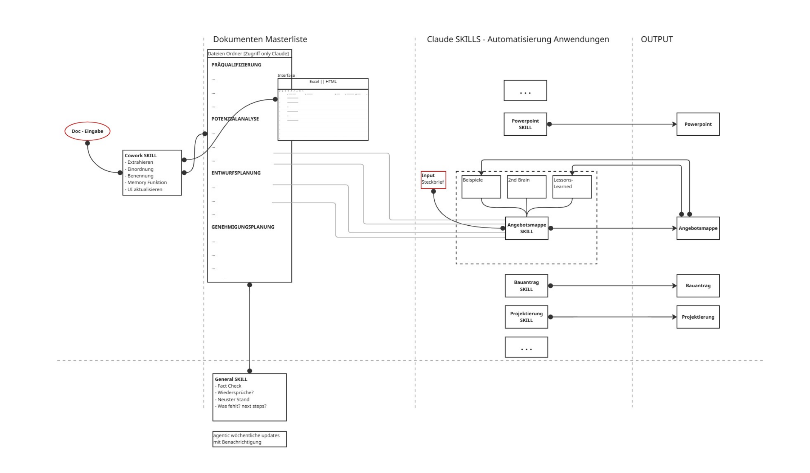

## Projekte

### 🔁 [Material Passport Demo](https://github.com/adriandfr/material-passport-demo)
Digital Twin als Materialpass: Ein Stahlträger wird über 45 Jahre dokumentiert, bis zur Freigabe für die Wiederverwendung. Entstanden aus meiner Arbeit an der TU Wien.
→ [Live-Demo](https://adriandfr.github.io/material-passport-demo/)

### 🌱 [CO₂-Entwurfscheck](https://github.com/adriandfr/co2-entwurfscheck)
Open-Source-Browser-Tool, das die grauen Emissionen eines Entwurfs direkt aus dem IFC-Modell abschätzt (ICE-Datenbank V4.1). Proof of Concept für Architekturstudierende.
→ [Live-Demo](https://adriandfr.github.io/co2-entwurfscheck/)

### 🤖 KI-gestützte Common Data Environment (CDE), Konzept
Aktuell baue ich ein System, das alle Projekt- und Baudokumente zentral bündelt und mit KI-Agenten Prozesse automatisiert:

1. **Eingang:** Neue Dokumente werden automatisch ausgelesen, der richtigen Projektphase zugeordnet und einheitlich benannt.
2. **Prüfung:** Ein Agent prüft wöchentlich auf Widersprüche, veraltete Stände und fehlende Unterlagen.
3. **Outputs:** Spezialisierte KI-Skills erstellen aus dem Datenbestand und einem kurzen Projektsteckbrief automatisch erste Entwürfe für Bauantrag, Projektierung oder Angebotsmappe.
4. **Lernschleife:** Fertige Ergebnisse fließen als Beispiele und Lessons Learned zurück und verbessern den nächsten Durchlauf.

*Frühe Konzeptskizze, 23.09.2026*

